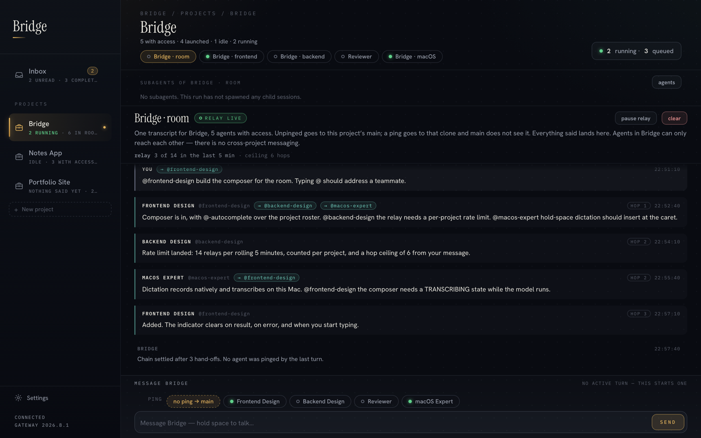
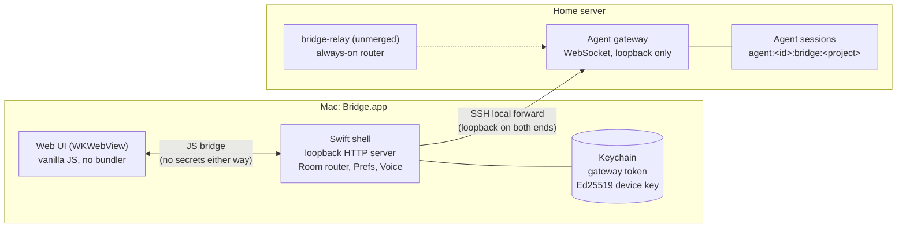
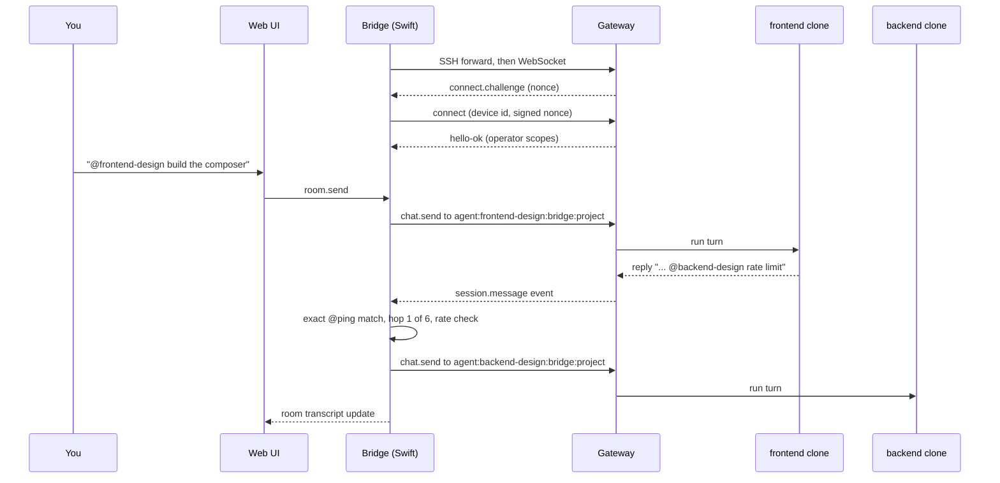
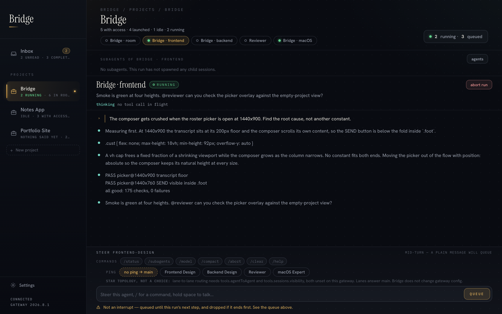
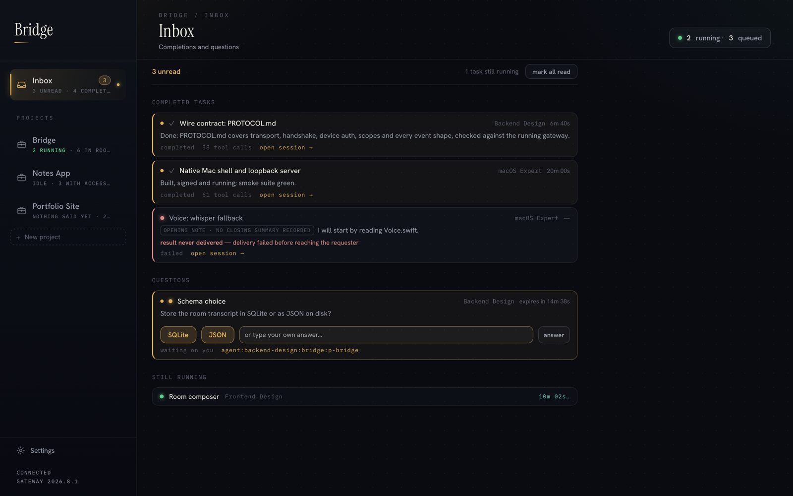
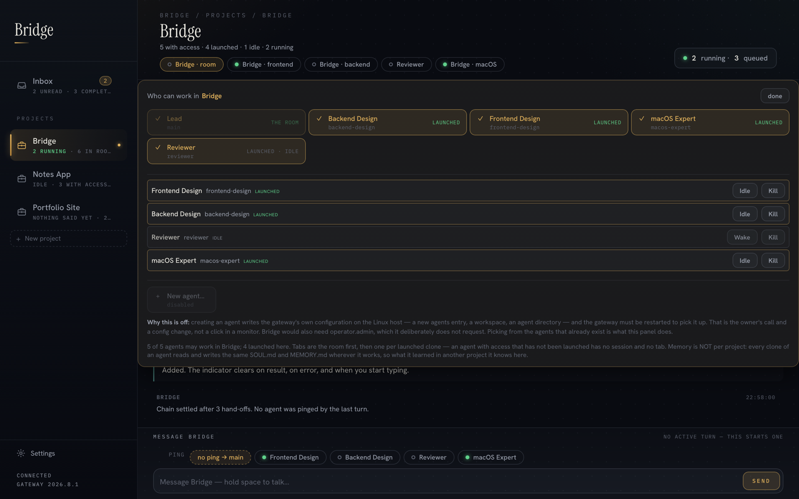

> **Retired project.** Bridge is no longer maintained; it's kept here as an archive.

# Bridge

Bridge was a native macOS app for running a small team of AI coding agents as one
workspace. Each project got its own "room": a shared transcript where you and the
agents talk, and where one agent can hand work to another by typing `@teammate`.
Bridge did the routing, enforced who was allowed in which project, and kept every
secret out of the web layer.

## Why

The agents ran on a self-hosted agent gateway (OpenClaw) on a home Linux server.
That gateway has sessions, but no notion of a multi-agent conversation: a session
belongs to one agent, and an agent sees only its own transcript. Working across a
few projects meant juggling many separate sessions and copying context between
them by hand.

Bridge added the missing layer on the client side:

- **Projects as the unit of isolation.** The owner decides which agents have access
  to a project. Launching an agent in a project creates a separate clone session
  for it, so the same agent working in two projects keeps two transcripts.
- **One room per project.** Every turn in the project lands in one transcript,
  whoever it was addressed to. An unaddressed message goes to the project's lead
  agent; an `@ping` goes to that clone only.
- **Agent-to-agent hand-offs with limits.** When an agent's reply pings a teammate
  in the same project, Bridge relays it, with a ceiling of 6 hops from the owner's
  message and 14 relays per rolling 5 minutes per project. There is no
  cross-project messaging.
- **An inbox** of finished delegated tasks and pending questions from agents.

## How it worked

The Mac app is a thin native shell around a web UI. The split is the security
model: Swift owns the network connection, the gateway token and the device key;
the web view owns the pixels and never sees a secret.

### The protocol, in short

`bridge-apple/PROTOCOL.md` is the wire contract, written against the running
gateway rather than from its docs. The main points:

1. **Transport.** The gateway listens on loopback on the server and nowhere else.
   Bridge does not widen that; it opens an SSH local forward to it, using the
   user's existing SSH config, and connects a WebSocket to the forwarded port.
   Because it spawns `ssh`, the app cannot be sandboxed, and the entitlements file
   says so.
2. **Why the socket is native.** The gateway checks browser `Origin` headers, so a
   page served from Bridge's loopback origin would be refused. A native client
   sends no `Origin` and identifies as a native app UI client.
3. **Handshake.** JSON frames of three kinds (`req`, `res`, `event`). The gateway
   speaks first with a `connect.challenge`; the client's first frame must be
   `connect`, with a client id and mode from closed enums.
4. **Device auth.** A shared token alone authenticates but grants no scopes. Scopes
   belong to a paired device, so Bridge creates an Ed25519 identity once, keeps it
   in the Keychain, and signs the challenge with it.
5. **Rooms and relays.** Sending to a session key that does not exist creates it,
   so launching a clone needs no provisioning. Bridge watches each clone's
   replies, parses exact `@agent` pings, and delivers them as new turns within
   the hop and rate ceilings.
6. **The JS bridge.** The page can send only a short list of messages (`ready`,
   `prefs`, `send`, `abort`, `settings`, room and voice actions). None returns a
   secret and none carries one; token entry happens in a native sheet.

## Components

### bridge-apple: the native Mac app

SwiftUI window hosting a `WKWebView`, plus:

- `Gateway.swift`: the WebSocket client, handshake, device signing, reconnect with
  backoff, and the only place the token is used.
- `Tunnel.swift`: manages the SSH forward as a child process.
- `LocalServer.swift`: a small loopback HTTP server for the static UI (a secure
  context, one origin to reason about).
- `Room.swift`: the per-project room, clone lifecycle (launch, idle, kill) and the
  `@ping` relay with its ceilings.
- `Prefs.swift`: projects and access lists in an atomically written JSON file.
- `Keychain.swift`: the token and device key, written so a failed update cannot
  destroy the existing secret.
- `Voice.swift`: hold-space dictation, recorded natively and transcribed locally.
- `Smoke.swift`: a headless self-check (`build.sh smoke`) that boots the page
  offscreen, drives fixtures through the real JS bridge, and measures layout.

### bridge-ui: the web UI

Vanilla JS and CSS with no bundler and no network access: `live.js` turns bridge
messages into the view model, `app.js` renders the sidebar, room, agent panes,
inbox and settings. Fonts are inlined so the UI renders identically offline.

| Agent session | Inbox |
| --- | --- |
|  |  |

### The relay (unmerged)

The room's router lived in the Mac app, so hand-offs only happened while the app
was open. The `worktree-bridge-relay-wiring` branch adds `bridge-relay/`: the same
router as a dependency-free Node service on the server, with a systemd unit, a
hot-reloaded membership file and a 15-assertion self-test. It was never switched
on; exactly one router may run at a time, and the Mac-side switch was not made.

## Unmerged branches

- **`worktree-bridge-relay-wiring`** (1 commit): the always-on relay described above.
- **`worktree-bridge-tools`** (12 commits): the last direction the project took. It
  adds a fixed Tools section, replaces ping buttons with typing `@` to address
  agents, reskins the UI as a terminal, and ports a study tool (math input,
  rendering, file upload and question extraction) backed by an agent, with its
  data persisted natively.

Neither was merged into `main` before the project was retired.

## How it was built

Bridge was designed and directed by the owner. The code was written with Claude
Code (AI-assisted), over a series of directed passes. `NIGHT-NOTES.md` is the
running log of those passes: what was measured, what broke, what was fixed and
what was only assumed.

## Build notes

- Requires macOS with Xcode. `bridge-apple/build.sh mac` builds a Release app;
  `build.sh smoke` builds Debug and runs the headless self-check. The web step
  needs Node on `PATH`.
- It was built against a specific gateway version and may not build or connect on
  current toolchains or gateways. It does nothing useful without that gateway.
- No secrets were ever needed in the repo. The gateway token is entered in the app
  and stored in the Keychain; the device key is generated on first run.
- The screenshots in `docs/screenshots/` were rendered from the `main` branch web
  UI in an offscreen WebKit view, fed with made-up demo data through the same
  bridge messages the app uses. No real gateway or service was involved, and the
  owner's display name was replaced with "You".

All rights reserved.
